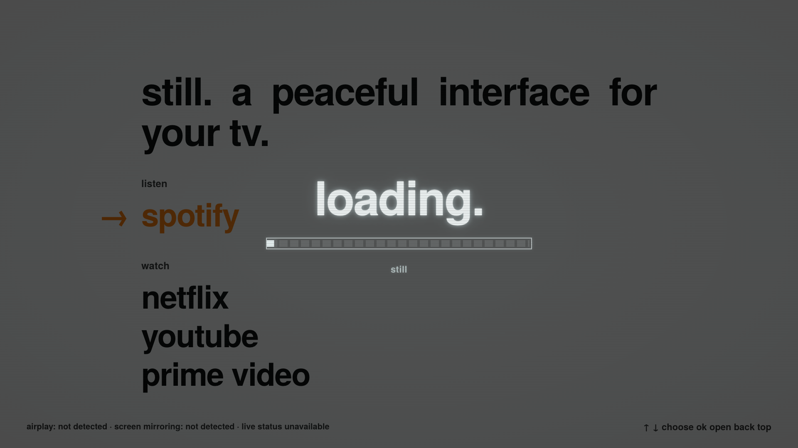
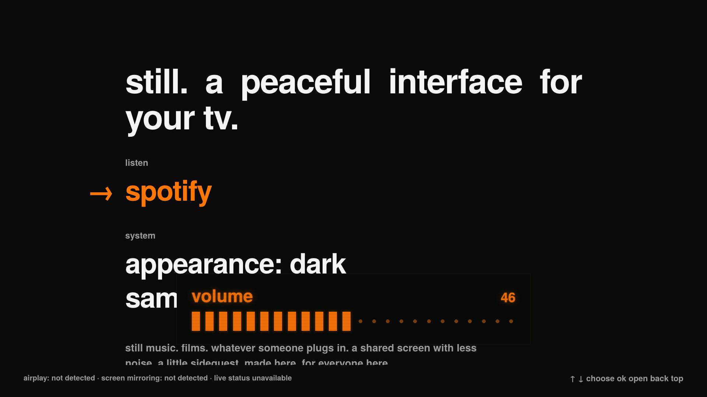

# STILL

### A peaceful interface for Samsung TVs.

**A minimal custom launcher for Samsung Tizen smart TVs.** Music, films, and whatever someone plugs in. Built for a shared office TV, with a remote-first interface, local assets, and a little CRT glow.

> music. films. whatever’s plugged in.
> a shared screen with a little room to breathe.

This is a developer-mode web app, not a firmware flash. Install it alongside your existing Samsung apps. Replacing the physical Home-button destination is a separate, experimental step with a much narrower compatibility range.

[Setup](#install-on-your-tv) · [Compatibility](#compatibility) · [Customization](#make-it-yours) · [Privacy](#privacy) · [Contributing](CONTRIBUTING.md)



*Browser preview; app availability and device status depend on your TV.*

<details>
<summary>CRT loading screen</summary>


</details>

## What it does

- A single, room-readable list with the remote's focus highlighted in orange.
- Spotify first; catalog apps appear only when installed.
- External inputs appear when the TV reports them connected.
- Auto, light, and dark appearance. Auto follows daylight calculated locally for San Francisco; the location is editable.
- CRT-inspired loading: phosphor glow, scanlines, and a segmented activity bar that clears when startup settles.
- An orange CRT volume display while the launcher is in the foreground.
- A Samsung Home entry at the bottom for the original interface and full settings.
- Bundled fonts and assets. No analytics, remote fonts, or network requests in the launcher.



The volume display works on this home screen. Samsung's native mute indicator can still appear alongside it. Other apps and HDMI retain Samsung's volume UI. The loading screen appears when the app starts; it does not replace Samsung's firmware boot logo.

## Compatibility

| Component | Status |
| --- | --- |
| Tested hardware | Samsung UN55CU7000FXZA, 2023 Crystal UHD |
| Tested software | Tizen 8.0; firmware `T-KSU2ECAKUC-0080-2024.2` |
| Current source version | `0.4.2` (branding update); hardware behavior tested with `0.4.1` |
| Other Samsung Tizen TVs | Intended for further testing. Manifest minimum is Tizen 6.5; this is not a verified compatibility guarantee. App IDs and available APIs can vary by model, region, and firmware. |
| Physical Home / startup routing | Confirmed on the tested TV only, using the optional native helper. Home from Netflix and a power-off/on cycle returned to the launcher. |
| HDMI and casting | Connected-input discovery is implemented; actual HDMI switching and casting sessions still need physical validation. Footer component detection does not establish receiver readiness. |
| Installation tools | The repository's signing and deployment scripts currently target macOS with Tizen Studio at `~/tizen-studio`. Windows/Linux workflows are not verified here. |

This is an independent project, unaffiliated with Samsung. It preserves native streaming apps and TV functionality; it is not an HDMI-only conversion.

## Try the interface first

```sh
git clone https://github.com/taikovv/television_ui_push.git
cd television_ui_push
open app/index.html
```

The `open` command is for macOS; elsewhere, open the file in your browser. Use arrow keys to navigate, Enter to select, Backspace to return, and **N** to cycle appearance. **V** previews the volume display; **+ / −** and **M** exercise its simulated volume and mute state.

A browser preview cannot control a TV or confirm hardware behavior.

## Install on your TV

Allow time for the SDK download and certificate sign-in. You need a Samsung Tizen TV with Developer Mode, a Mac on the same local network, Node.js 22 or newer, and a Samsung account for certificate issuance. Standard installation does not require the native helper or .NET.

### 1. Install the Samsung developer tools

Install [Tizen Studio and the Samsung TV SDK](https://developer.samsung.com/smarttv/develop/getting-started/setting-up-sdk/installing-tv-sdk.html). This project's tested setup used Tizen Studio 6.1.

Keep the SDK at `~/tizen-studio`, which is where the repository scripts look. In Package Manager, install the **Samsung TV Extension** and **Samsung Certificate Extension**. If the Intel tools require Rosetta on an Apple Silicon Mac, install it when macOS prompts.

### 2. Enable Developer Mode and connect

Follow Samsung's [TV device connection guide](https://developer.samsung.com/smarttv/develop/getting-started/using-sdk/tv-device.html): open **Apps → App Settings**, enter **12345**, enable Developer Mode, enter your **Mac's local IP address** as the Host PC IP, and restart the TV. Menu placement varies with firmware.

Find the **TV's local IP address** in its network status screen. The Mac address belongs in Developer Mode; the TV address belongs in the connection command:

```sh
~/tizen-studio/tools/sdb connect YOUR_TV_IP:26101
~/tizen-studio/tools/sdb devices
```

Replace `YOUR_TV_IP` with the actual address. The second command should list the TV as `device`. You can also connect through Tizen Studio's **Tools → Device Manager**, adding the TV address and port **26101**.

### 3. Create your own Samsung TV certificate

Use [Samsung's certificate guide](https://developer.samsung.com/smarttv/develop/getting-started/setting-up-sdk/creating-certificates.html):

1. Open **Tools → Certificate Manager**. Cancel a migration dialog if shown.
2. Choose **+ → Samsung → TV**. Name the profile **`tv-home`** so the commands below work unchanged.
3. Create an author certificate. Choose a certificate password, sign in with your Samsung account when prompted, and save the backup.
4. Create a **Public** distributor certificate and add **your TV's DUID** from the connected-device list. Finish the wizard.

Each installer creates their own certificate for their target TV. There is no universal signed download. Keep `author.p12`, `distributor.p12`, and their passwords private, and back them up outside the repository. Future updates must use the same author certificate.

The Samsung account used to issue the certificate does not need to be signed into the TV. If the SDK offers **Permit to install applications** in the connected device's context menu, complete that step before installing.

### 4. Save your local device configuration

Create the ignored configuration file:

```sh
mkdir -p .local
cat > .local/tv.json <<'JSON'
{
  "ip": "YOUR_TV_IP",
  "duid": "YOUR_TV_DUID"
}
JSON
```

Edit both placeholders. Copy the DUID from the certificate wizard's connected device, or query the connected Samsung TV:

```sh
~/tizen-studio/tools/sdb -s YOUR_TV_IP:26101 shell 0 getduid
```

Use your own TV's values. `.local/` is excluded from Git; do not include this file in public reports.

### 5. Build, sign, and install

From the repository directory:

```sh
node --test tools/appearance.test.mjs tools/library.test.mjs
node tools/build.mjs --sign tv-home
node tools/install.mjs
```

The build validates the bundle and signs it with your `tv-home` profile. The installer selects the newest signed `tv-home` package in `dist/`, installs it, and opens the app. The app appears as **still** on the TV.

To install a particular build, pass its path explicitly:

```sh
node tools/install.mjs dist/home-0.4.2-tv-home.wgt
```

**At this stage, physical Home still follows Samsung's normal behavior.** Standard app installation alone does not change the TV's Home routing.

### 6. Optional: make it the Home screen

The tested TV uses an unsupported, non-root native helper to change the Home destination. This is firmware-specific and is **not a general Samsung launcher setting**.

Read [Home routing and recovery](docs/HOME_ROUTING.md) before considering it. The helper deliberately rejects other platform/firmware combinations. Do not remove those guards to try another TV. Keep an original snapshot and recovery tools before applying any change, and restore Samsung Home before uninstalling the launcher.

## Make it yours

| File | What to change |
| --- | --- |
| [`app/catalog.js`](app/catalog.js) | App order, labels, matching rules, and app IDs. Spotify is first by default. Missing catalog apps stay hidden. |
| [`app/style.css`](app/style.css) | Layout, focus color, CRT treatment, and typography. |
| [`app/appearance.js`](app/appearance.js) | Latitude and longitude for offline daylight mode. Defaults: `37.7749`, `-122.4194` (San Francisco). The TV clock must be correct. |
| [`app/index.html`](app/index.html) | `Still` branding and the communal-screen note. |
| [`app/volume.js`](app/volume.js) | Foreground volume display behavior. |

App IDs in the catalog came from the tested TV. If an installed app is missing on another model, investigate its actual ID and matching rule; do not add fake availability. The footer's casting status describes detected components, not whether a casting session will succeed.

For a new build, increment the version in `app/config.xml`, then repeat the sign/install commands. Preserve the existing application/package IDs and author certificate when updating an installed copy, especially if it is your Home destination.

## Troubleshooting

| Symptom | Check |
| --- | --- |
| TV cannot be reached | TV powered on; same local network; Developer Mode points to the Mac's current IP; correct TV IP and port. Guest Wi-Fi/client isolation can block the connection. |
| Signing tool not found | SDK exists at `~/tizen-studio`; TV and certificate extensions are installed. |
| Package has no signatures | Certificate Manager contains the exact `tv-home` profile. The builder rejects unsigned output even if the SDK reports success. |
| Certificate rejected (`118, -12`) | A Samsung **TV** distributor certificate includes this TV's DUID and is valid. A generic Tizen certificate is insufficient for this setup. |
| Different author (`118, -11`) | Use the original author certificate. If starting over, restore native Home **before** uninstalling a copy used as the Home destination. |
| Home opens Samsung's screen | Expected after standard installation. Only the optional, guarded native route changes this on the tested firmware. |
| Samsung's mute popup is visible | Known limitation; the custom foreground display does not suppress the native indicator. |
| Day/night appearance seems wrong | Check TV time and the city coordinates in `app/appearance.js`, or choose light/dark manually. |

For help, [open an issue](https://github.com/taikovv/television_ui_push/issues/new/choose) with your model, Tizen version, firmware, and a redacted error. Never post certificates, passwords, DUIDs, account tokens, local addresses, or raw private probe logs.

## Privacy

The launcher bundles its assets and makes no network requests. Build checks reject network origins and common request APIs in the app source. This is a property of this launcher, not a claim about Samsung's OS or streaming apps.

The tested TV's advertising opt-out was read back successfully. Optional privacy controls were also disabled on the TV, but background services and external connections remain observable. No zero-tracking claim is made, and third-party app ads are not removed by this UI.

See the [privacy plan](docs/PRIVACY.md), [read-only TV audit](docs/PRIVACY_AUDIT.md), [volume investigation](docs/VOLUME.md), and [audio-output investigation](docs/AUDIO_OUTPUT.md). Network measurement and filtering are future work. Preserve streaming, casting, and recovery when changing TV settings.

## Development

No npm dependencies are needed for the app, logic tests, or unsigned packaging:

```sh
node --test tools/appearance.test.mjs tools/library.test.mjs
node tools/build.mjs
```

The unsigned build requires `zip` and writes `dist/home-<version>-unsigned.wgt`. It cannot be installed as-is. CI runs the logic tests and unsigned build without TV credentials.

The optional browser checks require Playwright and Google Chrome at the standard macOS application path:

```sh
npm install --no-save --package-lock=false playwright
node tools/check-browser.cjs
node tools/check-loading.cjs
node tools/check-volume.cjs
```

See [contributing](CONTRIBUTING.md) for compatibility reports and development boundaries. Native research tools are separate from the web app and require their own review and build steps.

## License and credits

Original project code is [MIT licensed](LICENSE), © 2026 Vladimir Taikov. Third-party licenses remain attached to their components: [TeX Gyre Heros / GUST Font License](app/fonts/GUST-FONT-LICENSE.txt), [SunCalc / MIT](app/licenses/SunCalc-LICENSE.txt), and [CleanFrame-derived native tooling / MIT](tools/native-home/CleanFrame-LICENSE.txt).

Certificates, passwords, device configuration, compiled TV packages, recovery snapshots, and private session notes are excluded from this repository. Keep your own private recovery backup; a Git clone does not contain it.
