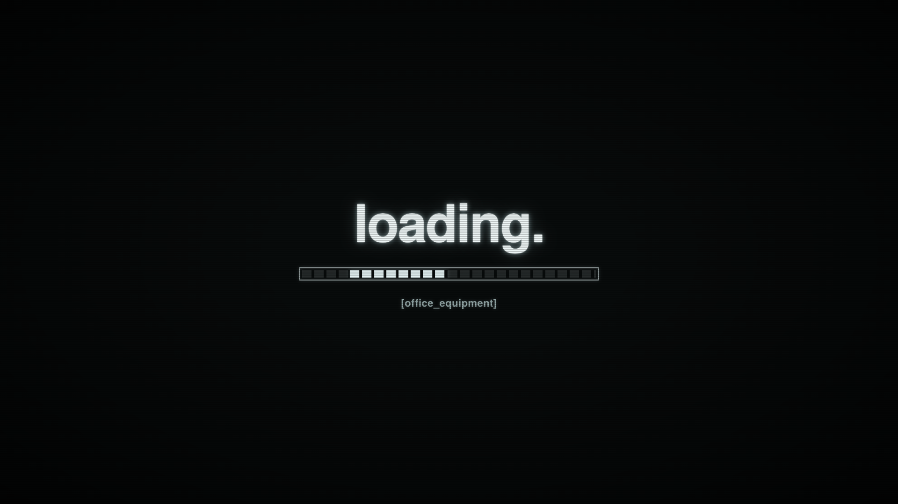

# [office_equipment]

A quiet home screen for a communal Samsung TV: music, films, whatever someone plugs in. A little sidequest in making shared equipment feel useful again.

## Current build

Source version 0.3.9 (signed and tested; TV deployment pending connectivity). Spotify comes first, missing apps stay hidden, and connected external inputs are discovered at runtime. The launcher uses bundled fonts and assets, with no analytics or network requests. Appearance offers auto/light/dark; auto calculates San Francisco daylight locally.

The launcher now has a CRT-style loading screen: the same bundled Heros font, pale phosphor glow, static scanlines and an indeterminate segmented activity bar. It clears when initial app/input discovery and font loading settle; it adds no minimum wait and does not replay on foreground return. Back exits early, and a five-second timeout exposes the menu if discovery stalls. Reduced-motion mode keeps the visual treatment without animation. This is app startup UI, not a replacement for Samsung’s firmware boot logo.



The custom Home button route and a power-off/on return to the launcher have been physically confirmed on a Samsung UN55CU7000FXZA running Tizen 8. HDMI switching and real casting sessions still need physical validation. Casting component detection in the footer is not a receiver health check.

## Preview and checks

Open `app/index.html` in a browser. Arrow keys navigate, Enter selects, Backspace returns, and N cycles appearance. Browser preview cannot establish TV hardware behavior.

```sh
node --test tools/appearance.test.mjs tools/library.test.mjs
node tools/build.mjs
```

Builds use Tizen Studio at `~/tizen-studio`; output goes to ignored `dist/`. The browser regression script `tools/check-browser.cjs` and the loading-state script `tools/check-loading.cjs` require Playwright and Google Chrome. No Node dependencies are required for the logic tests.

## Install on a TV

1. Install Tizen Studio and Samsung's TV/certificate extensions. Enable Developer Mode on the TV with the development computer's LAN address.
2. Create a Samsung TV signing profile for your own device using Certificate Manager. Keep all certificates and passwords private. A Samsung account used for certificate issuance does not need to be signed into the TV.
3. Create private `.local/tv.json` with `ip` and `duid` fields for the intended TV. Do not commit it.
4. Sign and deploy:

```sh
node tools/build.mjs --sign tv-home
node tools/install.mjs
```

The manifest's app identity is preserved for updates. Reuse the original author certificate when updating an existing installation. The native helper is separately scoped to a specific model/firmware and is not a general-purpose installer.

## Native Home routing and recovery

`tools/native-home/` contains the unsupported, non-root, one-shot Home routing helper used on this build. It is guarded to Tizen 8 ARM32, SDK UID 901, the configured device ID, the exact firmware and an installed eligible launcher. It uses a package-name command-execution workaround and installs no resident service. It is optional; installing the web app does not automatically remap Home.

Read `tools/native-home/RECOVERY.txt` and review the code before use. The native helper needs compiled .NET 6 outputs and a privately captured original snapshot; those are intentionally absent from this public repository. Do not run apply without a valid original snapshot. Preserve existing recovery files separately; restore native Home before uninstalling or changing the launcher identity. This repository alone is not a backup of an already modified TV.

The helper project can be compiled with a compatible .NET SDK:

```sh
dotnet build tools/native-home/Control.csproj -c Release -o .local/native-home/out
```

Home/startup behavior is firmware-specific. Keep the tested Home autostart configuration when disabling promotional features, and review recovery before firmware updates.

## Privacy work

See [the privacy plan](docs/PRIVACY.md). Optional TV privacy consents were reported disabled by the user; traffic measurement and filtering are deferred. Native streaming, casting and HDMI remain requirements. The launcher does not remove ads or recommendations inside third-party apps, and no claim of zero OS tracking is made.

## Repository contents

- `app/`: launcher, bundled font, icon and third-party notices.
- `tools/`: packaging, installation, TV control, tests and native Home tooling.
- `mockups/`: original design directions.
- `docs/`: privacy plan with office network details removed.

Certificates, credentials, local device configuration, compiled packages, recovery snapshots and private session notes are excluded. Third-party licenses are retained beside the corresponding font, solar calculation and native helper sources. No additional license for original project code has been selected.
